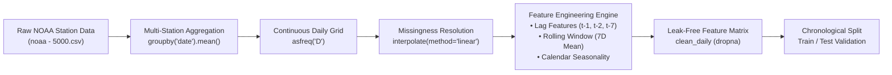

# Time-Series Analysis & Climate Risk Forecasting in Python

[](https://www.python.org/)
[](https://jupyter.org/)
[](https://pandas.pydata.org/)
[](https://scikit-learn.org/)
[](https://altschoolafrica.com/)
[](LICENSE)

An end-to-end time series analysis and feature engineering repository designed for climate risk modeling, temperature forecasting, and temporal data science. This repository demonstrates production-grade workflows for handling temporal dependencies, feature engineering, and avoiding look-ahead bias in machine learning pipelines.

---

## 📌 Executive Summary & Philosophy

> **"The Video, Not The Snapshot"**  
> Traditional machine learning often treats observations as independent and identically distributed (I.I.D.) snapshots—like shuffling a deck of photographs. **Time series data is a continuous video**: every frame carries momentum, history, and sequential causality.

In temporal forecasting:
* **Shuffling breaks reality**: Standard cross-validation (`train_test_split(shuffle=True)`) leaks future information into past predictions.
* **Look-Ahead Bias (Time Travel Leakage)**: Using data that would not have been available at the decision point invalidates real-world deployment.
* **Sequential Integrity**: Preserving the chronological arrow of time is paramount for genuine predictive power.

---

## 🔬 Core Components of Time-Series Dynamics

Every time series signal can be decomposed into foundational dynamics:

| Component | Nature | Real-World Analog | Mathematical Focus |
| :--- | :--- | :--- | :--- |
| **Trend** | Long-term progression | Rising average global temperatures over decades | Secular drift, moving averages, polynomial trends |
| **Seasonality** | Repeating clock | Warmer summer months, colder winter lows | Periodic oscillations, Fourier terms, calendar features |
| **Autocorrelation** | Today's momentum | Today's temperature strongly predicts tomorrow's | Serial correlation, lag operators ($y_{t-k}$), PACF |

---

## 🌦️ Case Study: NOAA Daily Weather Observations

The practical foundation of this project analyzes National Oceanic and Atmospheric Administration (**NOAA**) meteorological observations spanning multi-station records to model and forecast daily ambient temperatures.

### Monitored Meteorological Indicators:
* **`temp`**: Mean daily temperature (°F)
* **`dewp`**: Mean dew point (°F)
* **`slp` / `stp`**: Sea level pressure & station pressure (mb)
* **`visib` & `wdsp`**: Atmospheric visibility (miles) & mean wind speed (knots)
* **`prcp`**: Total daily precipitation (inches)
* Extreme indicators: Max/min sustained readings, fog, rain/drizzle, snow/ice, thunder.

---

## 🛠️ Pipeline Architecture & Methodology



### 1. Ingestion & Aggregation
Individual weather station readings are consolidated chronologically:
```python
daily = noaa_data.groupby('date')['temp'].mean().reset_index().sort_values('date')
```

### 2. Temporal Grid Enforcement & Linear Interpolation
A time series must have an unbroken temporal index. Gaps are made explicit using daily frequency (`'D'`) and filled through temporal linear interpolation:
```python
daily = daily.set_index('date').asfreq('D')
daily['temp'] = daily['temp'].interpolate(method='linear')
```

### 3. Leak-Free Feature Engineering
To arm regression models (e.g., Random Forest, Gradient Boosters, Ridge) with temporal awareness without leakage:

* **Lag Features ($t-1, t-2, t-7$)**:
  Capture immediate autocorrelation (yesterday, two days ago) and weekly cycle persistence.
  ```python
  daily['temp_lag_1'] = daily['temp'].shift(1)
  daily['temp_lag_2'] = daily['temp'].shift(2)
  daily['temp_lag_7'] = daily['temp'].shift(7)
  ```
* **Rolling Window Aggregations (7-Day Moving Baseline)**:
  Measures trailing weekly averages. Crucially, the rolling window is shifted by 1 day (`shift(1)`) to avoid target leakage into the predictor:
  ```python
  daily['temp_rolling_7'] = daily['temp'].shift(1).rolling(window=7).mean()
  ```
* **Calendar & Cyclical Indicators**:
  Explicitly model annual solar seasonality through calendar date embeddings:
  ```python
  daily['month'] = daily.index.month
  daily['day_of_year'] = daily.index.dayofyear
  ```

### 4. Chronological Validation
Data is partitioned chronologically (e.g., training on earlier historical windows and validating exclusively on future holdouts) to simulate true live deployment.

---

## 📁 Repository Structure

```
Time-Series-Analysis-Python/
│
├── 2nd_live_session.ipynb   # Interactive analysis, preprocessing & feature engineering
├── noaa - 5000.csv          # NOAA daily weather observation dataset
├── requirements.txt         # Pinned python environment dependencies
├── .gitignore               # Clean git tracking exclusions
└── README.md                # Comprehensive project documentation
```

---

## 🚀 Quickstart & Reproduction

### Prerequisites
* Python 3.9 or higher
* Git

### Installation

1. **Clone the repository**:
   ```bash
   git clone https://github.com/Scriptnedu/Time-Series-Analysis-Python.git
   cd Time-Series-Analysis-Python
   ```

2. **Create and activate a virtual environment** (recommended):
   ```bash
   # Windows (PowerShell)
   python -m venv venv
   .\venv\Scripts\Activate.ps1

   # macOS / Linux
   python3 -m venv venv
   source venv/bin/activate
   ```

3. **Install dependencies**:
   ```bash
   pip install -r requirements.txt
   ```

4. **Launch Jupyter Lab or Notebook**:
   ```bash
   jupyter notebook
   ```
   Open `2nd_live_session.ipynb` to explore the complete interactive workflow.

---

## 📊 Tech Stack & Tools

* **Language**: Python 3
* **Data Manipulation**: Pandas, NumPy
* **Machine Learning**: Scikit-Learn
* **Visualization**: Matplotlib, Seaborn
* **Environment**: Jupyter Notebook / Google Colab

---

## 🔮 Future Roadmap

- [ ] Multi-step recursive and direct multi-horizon forecasting.
- [ ] Classical statistical benchmarks: ARIMA, SARIMAX, and Exponential Smoothing (ETS).
- [ ] Modern additive models: Meta's Prophet with custom climate changepoints.
- [ ] Deep learning architectures: Temporal Convolutional Networks (TCN) & LSTM recurrent networks.
- [ ] Model explainability: SHAP values for lag and rolling feature importance analysis.

---

## 👤 Author & Acknowledgments

* **Chinedu Nkobie**  
  * GitHub: [@Scriptnedu](https://github.com/Scriptnedu)
  * Program: **AltSchool Africa** — School of Data Science (4th Semester: Time Series Analysis)

---

## 📄 License

This repository is open-source and distributed under the [MIT License](LICENSE).
